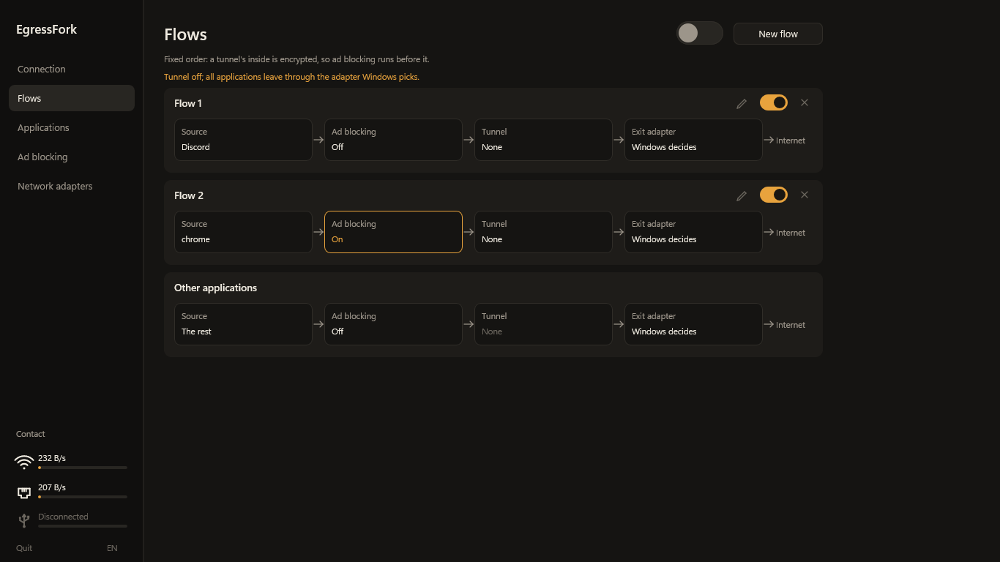

# EgressFork

Windows'ta her uygulamanın internete hangi bağlantıdan çıkacağını siz seçin: oyun kablodan, tarayıcı Wi-Fi'dan,
sohbet bir tünelden; geri kalan her şey Windows'un seçtiği yoldan.

Choose which connection each Windows app uses: a game on Ethernet, the browser on Wi-Fi, chat through a tunnel,
everything else on the route Windows picks.

**Site / Website:** https://iamfusta.github.io/egressfork/

- Kullanım ve ekran görüntüleri / How to use and screenshots: https://iamfusta.github.io/egressfork/
- Gizlilik / Privacy: https://iamfusta.github.io/egressfork/gizlilik.html
- Lisanslar / Licenses: https://iamfusta.github.io/egressfork/#lisanslar (powered by [sing-box 1.14.4](https://github.com/SagerNet/sing-box/tree/v1.14.4), GPL-3.0)
- Destek / Support: fustademo@gmail.com

Bu depo yalnız tanıtım sitesini barındırır (`index.html`, `gizlilik.html`, `ekran/`).
This repository hosts the website only.
